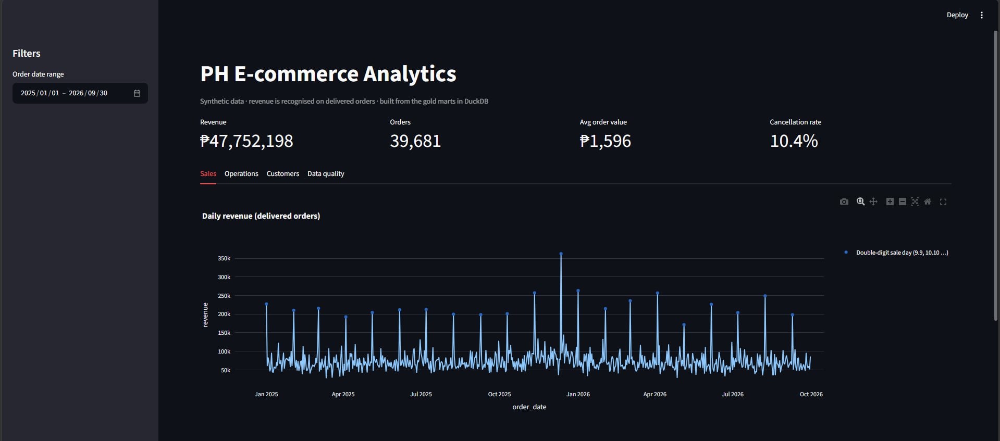
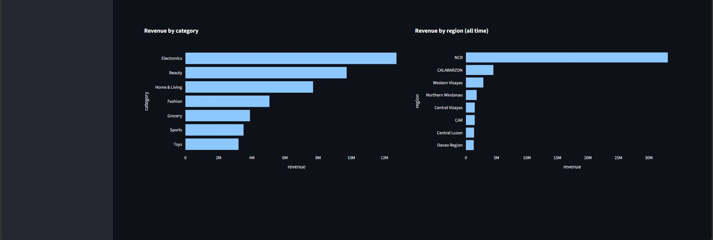
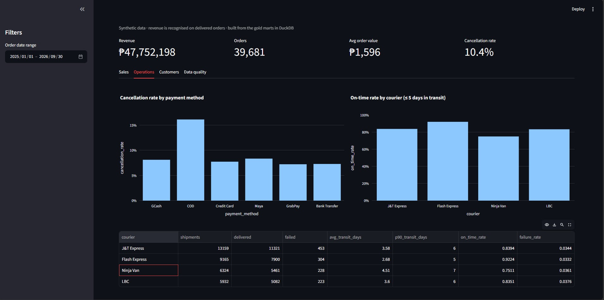
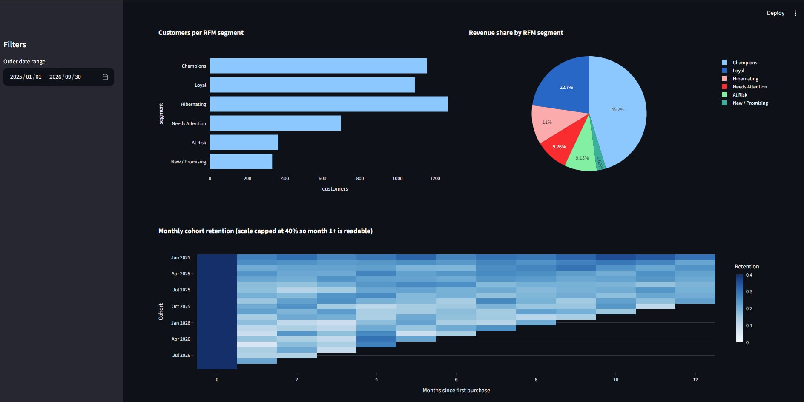
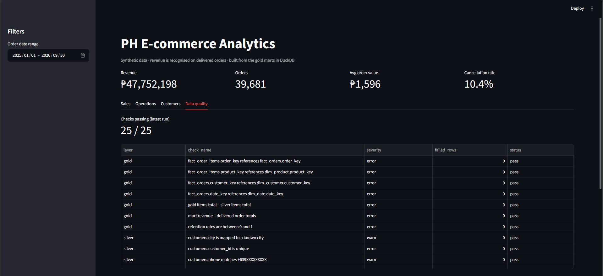
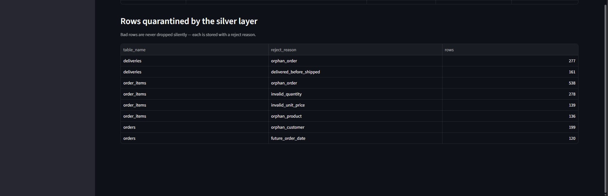
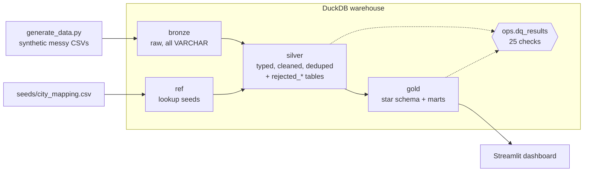
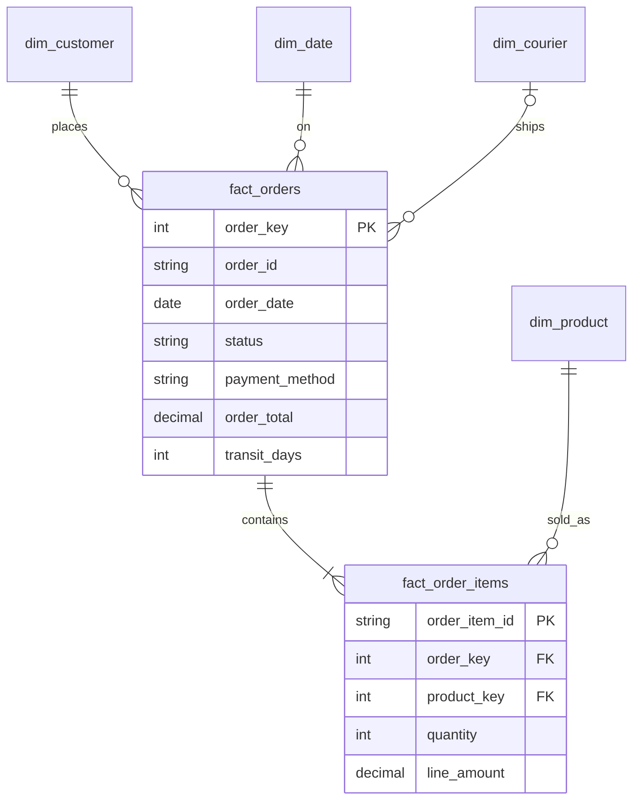

# PH E-commerce Analytics Pipeline

An end-to-end data engineering project: messy operational data goes in, a tested star-schema warehouse and a dashboard come out.

## Dashboard

### Sales



### Operations


### Customers


### Data quality




The data is **synthetic** (generated by `src/generate_data.py`) and models a Philippine online store: GCash/Maya/COD payments, J&T/LBC/Flash/Ninja Van couriers, Metro Manila-heavy customers, and 9.9 / 11.11 / 12.12 sale days. It is deliberately dirty — mixed date formats, inconsistent casing, duplicate rows, orphan foreign keys, impossible values — so the pipeline has real cleaning and validation work to do.

## Architecture



| Layer | What happens | Where |
|---|---|---|
| **bronze** | Raw files loaded as-is (all `VARCHAR`) plus `_source_file` and `_loaded_at` lineage columns. Nothing is coerced or dropped at the door. | `src/ingest.py` |
| **silver** | Parse 3 date formats, standardise status / payment / courier / category spellings, normalise PH phone numbers to E.164, map city → province → region, deduplicate, and **quarantine bad rows with a reason** instead of deleting them. | `sql/silver/` |
| **gold** | Star schema (`dim_date`, `dim_customer`, `dim_product`, `dim_courier`, `fact_orders`, `fact_order_items`) and analytics marts (daily sales, category, payment, courier, region, RFM, cohort retention). | `sql/gold/` |
| **ops** | `run_log` (step timings and status) and `dq_results` (every check, every run). | `src/pipeline.py`, `src/quality.py` |

### Data model



Business rule: **revenue is recognised on `delivered` orders only.** Cancelled, failed, pending and returned orders count toward GMV and order counts but not revenue.

## Quickstart

```bash
git clone https://github.com/<your-username>/ph-ecommerce-pipeline.git
cd ph-ecommerce-pipeline
python -m venv .venv && source .venv/bin/activate     # Windows: .venv\Scripts\activate
make setup        # pip install -r requirements.txt
make all          # generate data + run bronze -> silver -> gold -> data quality  (~5 seconds)
make test         # 24 tests
make dashboard    # http://localhost:8501
```

No `make`? Run the commands directly: `python -m src.pipeline --regenerate`, `python -m pytest`, `streamlit run dashboard/app.py`.

## Data quality

25 checks run after every build (`src/quality.py`). Each is a SQL query that returns the number of failing rows; results are written to `ops.dq_results`. A failing **error** check stops the pipeline with a non-zero exit code (so CI goes red); **warn** checks are reported only.

- **Keys & nulls:** primary keys unique, required columns not null
- **Domains:** status, payment method, courier within accepted values; no future dates; positive quantities and prices; delivery never before shipping
- **Reconciliation:** `bronze distinct ids = silver rows + rejected rows` for orders and order items, so nothing disappears silently
- **Referential integrity:** every fact row resolves to its dimensions
- **Totals:** gold item totals equal silver; mart revenue equals delivered order totals

On the default dataset the silver layer quarantines 319 orders, 1,091 order items and 438 deliveries (all with a `reject_reason`), and the dashboard's *Data quality* tab shows them.

## Example findings

The generator bakes in realistic patterns, and the marts recover them — which is the point: it shows the pipeline preserves signal while cleaning noise. *(These are properties of synthetic data, not real-world conclusions. Default seed 42, 40,000 orders.)*

| Question | Answer from the marts |
|---|---|
| Does COD hurt? | COD cancellation rate is **16.1%** vs 7–8% for every other payment method (`mart_payment_method_performance`) |
| Which courier is slowest? | Ninja Van: **75%** on-time (≤ 5 days in transit) vs Flash Express **92%** (`mart_courier_performance`) |
| Do sale days matter? | Double-digit sale days average **192 orders/day vs 58** on normal days; paydays (15th / month-end) see about **1.3×** (`mart_daily_sales`) |
| Where is the revenue? | NCR contributes **69%** of delivered revenue (`mart_region_sales`) |
| Who are the best customers? | "Champions" are ~23% of buyers but **45% of revenue** (`mart_customer_rfm`) |

## Project structure

```
.
├── src/
│   ├── generate_data.py   # synthetic messy data (seeded, deterministic)
│   ├── ingest.py          # bronze load + seed load
│   ├── pipeline.py        # orchestrator: runs SQL layers in order, logs to ops.run_log
│   └── quality.py         # declarative data quality checks
├── sql/
│   ├── 00_schemas.sql     # schemas, ops tables, title_case macro
│   ├── silver/            # 01_customers … 05_deliveries
│   └── gold/              # 01_dimensions, 02_facts, 03_marts
├── seeds/city_mapping.csv # city spellings -> city / province / region (single source of truth)
├── dashboard/             # Streamlit app + tested query layer
├── tests/                 # unit (SQL rules), integration (full pipeline), DQ framework, dashboard
├── docs/DECISIONS.md      # why DuckDB, why medallion, why SQL-first
└── .github/workflows/ci.yml
```

## Testing

- **SQL rule unit tests** run each silver file against a tiny hand-written bronze table (phone formats, date formats, duplicate handling, reject reasons).
- **Integration tests** run the whole pipeline on 3,000 orders and assert reconciliation, referential integrity, revenue totals, RFM coverage, and idempotency (re-running gives identical row counts).
- **DQ framework tests** prove the checks actually fail on bad data — green checks only mean something if they can go red.
- **CI** (GitHub Actions) runs lint, tests, and the full pipeline on every push.

## Design choices and limits

See [`docs/DECISIONS.md`](docs/DECISIONS.md). In short: DuckDB keeps the project zero-infrastructure and reproducible; transformations are plain SQL so they are reviewable and portable to dbt; the pipeline is a full refresh, which is right at this scale but is the first thing to change at larger volumes.

## Ideas to extend

- Replace the generator with a real or public dataset (e.g. an Olist-style e-commerce export) and keep the same silver/gold structure
- Incremental loads keyed on `_loaded_at` instead of full refresh
- Port the SQL models to dbt (the layering and tests map directly)
- Schedule with Airflow or Dagster; write marts to Postgres or BigQuery
- Add slowly changing dimension (Type 2) history for customer city changes
